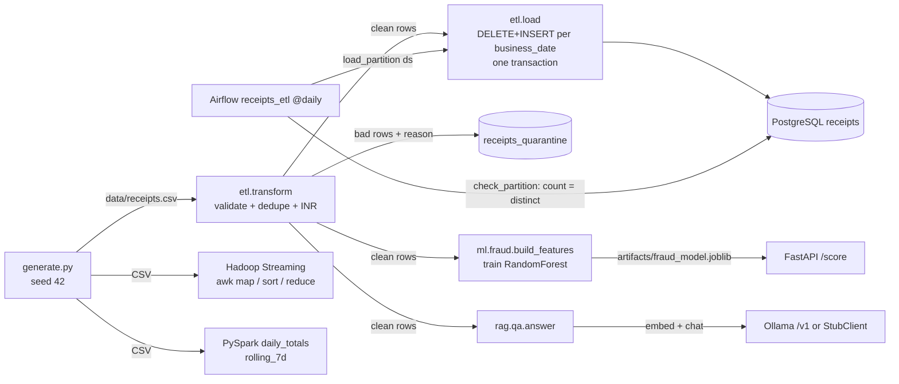

# misc-lab-3 architecture: receipts data & ML platform

Written 11 Nov 2026 from the code on branch `miscellaneous-3` (commit `c1df9629`). All data is synthetic.

## Components

| Component | File | Role |
|---|---|---|
| Generator | `receipts/generate.py` | Seeded (42) synthetic receipts: 3,000 normal + 3 injected fraud patterns + 15 duplicates + 5 bad rows |
| ETL | `receipts/etl.py` | extract CSV -> validate -> dedupe -> FX to INR (Decimal) -> idempotent load into PostgreSQL |
| Orchestration | `airflow/dags/receipts_etl_dag.py` | `@daily` DAG, one partition (`{{ ds }}`) per run, retries, post-load check |
| Batch analytics | `spark/daily_spend.py` | PySpark `local[2]`: daily totals, range-based rolling 7-day spend |
| MapReduce | `hadoop/mapper.awk`, `hadoop/reducer.awk`, `hadoop/run-streaming.sh` | Hadoop Streaming count + total per currency (local job runner) |
| Fraud model | `ml/fraud.py` | Point-in-time features, RandomForest, precision/recall/ROC-AUC, joblib artifact |
| Scorer API | `ml/api.py` | FastAPI `/score`, `/health` |
| RAG Q&A | `rag/qa.py`, `rag/llm.py` | Deterministic question parser + exact total + embedding retrieval + LLM phrasing with a guard |
| Local stack | `docker-compose.yml` | Postgres 16 (host 5433), scorer on :8000, optional Ollama (`--profile llm`) |

## Data flow

## Failure modes and how the code handles them

| Failure | Handling | Where | Test |
|---|---|---|---|
| Bad row (non-numeric / non-positive amount, unknown currency, bad timestamp, missing id or payer) | Row goes to quarantine with a reason; batch continues | `receipts/etl.py:35-58`, `61-72` | `tests/test_etl.py:11` (all 5 reasons) |
| Duplicate delivery of a receipt | Dropped on `receipt_id`, first wins | `receipts/etl.py:67-68` | `tests/test_etl.py:22` |
| Retry or re-run of a load | Delete the partition(s) then insert, all in one transaction | `receipts/etl.py:80-92` | `tests/test_etl.py:52` (rerun = same count), `:61` (one day only) |
| Airflow task fails transiently | 3 retries, 2 min base delay, exponential backoff | `receipts_etl_dag.py:47-48` | `airflow/test_dag_integrity.py:21` |
| Input file missing | `ShortCircuitOperator` skips the rest of the run | `receipts_etl_dag.py:20-21`, `51` | DagBag shape test only |
| Duplicates slipped into a partition | `check_partition` fails the run if `count != count(distinct)` | `receipts_etl_dag.py:31-38` | Exercised by the two `airflow dags test` runs (RUN-RESULTS) |
| Concurrent backfills | `max_active_runs=1` | `receipts_etl_dag.py:46` | `test_dag_integrity.py:18` |
| Payer skips days in the rolling window | `rangeBetween` over epoch seconds, not `rowsBetween` | `spark/daily_spend.py:27-29` | `tests/test_spark.py:33` |
| Bad row in MapReduce | Dropped, `bad_rows` Hadoop counter incremented | `hadoop/mapper.awk:6-10` | `tests/test_hadoop.py:13` |
| Feature leakage | Features built in timestamp order from history before the row | `ml/fraud.py:21-40` | `tests/test_ml.py:23` |
| Model file absent at serve time | HTTP 503 "model not trained" | `ml/api.py:20-26` | `tests/test_ml.py:55` |
| Invalid score input | Pydantic bounds -> 422 | `ml/api.py:12-17` | `tests/test_ml.py:50` |
| LLM invents a number | Answer must contain the computed total, else the FACTS template is returned | `rag/qa.py:68-71` | `tests/test_rag.py:55` |
| Question without a payer | Refuses, `total=None` | `rag/qa.py:54-55` | `tests/test_rag.py:65` |

Known gaps (read from the code, not fixed here):
- In the Airflow path `load(..., business_date=d)` never writes `receipts_quarantine` (`etl.py:85`, `90`): only a full
  load records bad rows. The DAG log line `quarantined_total` is the in-memory count, not stored rows.
- The ML train/test split is random and stratified (`ml/fraud.py:45`), not time-ordered, so test receipts can be older
  than training receipts. Features are point-in-time; the split is not.
- The Hadoop job does no dedupe and only checks amount and currency, so its counts include the 15 duplicates and miss
  the bad-timestamp and empty-payer rows (RUN-RESULTS: 3,142 lines, `bad_rows=3`, vs 3,125 clean rows in the ETL).
- FX rates are a fixed table (`etl.py:15`, duplicated as floats in `spark/daily_spend.py:38`).

## Architecture decisions (ADRs)

**ADR-1: Quarantine instead of fail-the-batch.**
Decision: `validate` returns `(row, None)` or `(None, reason)`; bad rows are stored with the reason (`etl.py:35-58`).
Alternatives: fail the whole file on the first bad row; drop bad rows silently.
Why: one bad upstream row should not block a day of good data, and silently dropped rows cannot be fixed and replayed.

**ADR-2: Idempotent partition overwrite (delete + insert in one transaction).**
Decision: the load unit is a business date; `with conn:` makes delete and insert commit together (`etl.py:80-92`).
Alternatives: `INSERT ... ON CONFLICT (receipt_id) DO UPDATE` (upsert); append-only with dedupe at read time.
Why: an upsert never removes a row that disappeared from a corrected source file; partition overwrite gives "the
partition equals the latest source" and makes Airflow retries and backfills safe. Cost: the partition is rewritten in full.

**ADR-3: Thin DAG, logic in plain Python.**
Decision: the DAG only calls `receipts.etl.run` (`receipts_etl_dag.py:24-28`); the logic is unit tested without Airflow.
Alternatives: logic inside operators; a SQL-only pipeline.
Why: Airflow is hard to unit test; DagBag tests (`airflow/test_dag_integrity.py`) cover import errors, shape and retries.

**ADR-4: Money as `Decimal` in the ETL and RAG, `NUMERIC` in Postgres.**
Decision: `Decimal(row["amount"])`, `quantize(Decimal("0.01"))` (`etl.py:42`, `56`; `rag/qa.py:62`).
Alternatives: float.
Why: float rounding errors in totals. Exception: Spark and the ML features use doubles (`daily_spend.py:38`,
`fraud.py:30`), acceptable for aggregates and model inputs, not for a ledger.

**ADR-5: The LLM phrases, the code computes.**
Decision: parse -> filter -> exact Decimal total -> retrieve citations -> LLM writes one sentence -> guard (`rag/qa.py:52-71`).
Alternatives: give the LLM the receipts and ask for the total; text-to-SQL.
Why: small models make arithmetic errors; the guard makes a hallucinated figure fall back to the template.
Cost: the regex parser only understands "payer_NNN", a currency code, "last week" and "on YYYY-MM-DD" (`qa.py:36-45`).

**ADR-6: OpenAI-compatible client plus a deterministic stub.**
Decision: one interface (`embed`, `chat`), `OpenAICompatibleClient` for Ollama `/v1`, `StubClient` with hashed trigram
embeddings (`rag/llm.py`).
Alternatives: vendor SDK; a vector database.
Why: tests run offline and reproducibly; switching to a hosted model is config (`LLM_BASE_URL`, `LLM_MODEL`). In-memory
cosine search is fine for ~3k rows; a vector DB would be the next step at scale.
